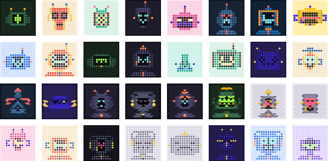

# botling

Seeded robot avatars drawn on a grid of squares, circles, triangles or diamonds.
Try it at **[botling.me](https://botling.me)**.



- **Same seed, same robot.** Pass a user id and you get the same robot every time, on any machine, with no storage.
- **Four grids.** Every robot can be drawn with square, circle, triangle or diamond cells.
- **Reads at any size.** Below 40px it switches to a simpler version of the same robot, so a 24px avatar still has a face.
- **Small and self-contained.** Zero dependencies, returns an SVG string, no network requests, works in the browser, Node and edge runtimes.
- **MIT licensed**, art included.

> Status: pre-release (0.x). The art is still being tuned, so robots may change between 0.x versions. From 1.0, the robot a seed draws only changes in a major version.

## Install

```sh
npm install botling
```

## Use

```ts
import { botling, botlingDataUri } from 'botling';

// An SVG string, for inlining.
const svg = botling(user.id);

// A data: URI, for  or CSS url().
const src = botlingDataUri(user.id, { size: 48 });
```

React:

```tsx

```

Use an opaque, stable id as the seed (a database id or UUID), not an email address or username. The seed never appears in the SVG, but anyone can render the robot for a guessed email and compare.

### Options

| Option | Type | Default | What it does |
|---|---|---|---|
| `shape` | `'square' \| 'circle' \| 'triangle' \| 'diamond'` | picked by the seed | Cell shape. |
| `palette` | `number \| Palette` | picked by the seed | Index into `PALETTES` (0-11), or a palette object: one of `HOLIDAY_PALETTES`, or your own with hex colours. |
| `size` | `number` | `96` | Width and height in pixels. The SVG scales cleanly to any size. |
| `detail` | `'auto' \| 'full' \| 'small'` | `'auto'` | `'full'` is the detailed 15x15 robot. `'small'` is a simpler 9x9 robot from the same traits, with touching cells, made to read at 24px. `'auto'` draws `'small'` below 40px. |
| `showGrid` | `boolean \| 'auto'` | `'auto'` | Draw the empty grid cells. `'auto'` draws them from 40px up; below that they read as noise. The small robot never draws them. |
| `background` | `boolean` | `true` | Draw the palette's background square. |
| `title` | `string \| null` | `'Robot avatar'` | Accessible name. `null` marks the image decorative (`aria-hidden`). |

Bad options (an unknown shape, an out-of-range palette, a palette colour that isn't hex, a size of 0) throw a `RangeError` rather than drawing nothing.

### Holiday palettes

`HOLIDAY_PALETTES` has New Year's, Valentine's, St Patrick's, Fourth of July, Halloween and Christmas. A seed never picks one, so everyday robots don't change; pass one in to dress the same robot up for the day:

```ts
import { botling, HOLIDAY_PALETTES } from 'botling';

botling(user.id, { palette: HOLIDAY_PALETTES.halloween });
```

### Building a picker

Everything that goes into a robot is exported, so you can offer users a choice:

```ts
import { botling, PALETTES, SHAPES, traits } from 'botling';

// Let someone choose a shape and palette for their own seed.
const options = SHAPES.flatMap((shape) => PALETTES.map((_, palette) => botling(user.id, { shape, palette, size: 48 })));

// Or show what a seed is made of.
traits(user.id); // { head: 'tv', eyes: 'visor', mouth: 'grille', top: 'antenna', ... }
```

Store the user's chosen `shape` and `palette` next to their seed, and pass them back in.

## How it works

The seed is hashed (FNV-1a) into a small seeded generator (mulberry32), which picks a palette, head, eyes, mouth, top, side pieces and a few sizes. Those are drawn as roles (body, shade, screen, glow, accent) onto a 15x15 grid, mirrored down the centre column. Small avatars use a 9x9 grid drawn from the same traits. The renderer then draws each cell in the chosen shape and colours each role from the palette.

Today that's 12 palettes, 7 heads, 10 eyes, 8 mouths, 7 tops, 4 side pieces, 4 shapes and a few size and on/off traits: well over 10 million distinct robots.

## Versioning

The picture is the API. Within a major version, a seed with the same options always draws the same robot. Anything that changes an existing seed's robot (art, palette colours, the order or length of any parts list) is a major version. Snapshot tests guard this.

## Developing

```sh
npm install
npm test          # vitest
npm run lint      # biome
npm run typecheck
npm run build     # tsc to dist/
npm run preview   # writes preview.html: a contact sheet at 24, 32, 48 and 96px
npm run site      # builds the playground site into dist-site/
npm run serve     # serves it on localhost:4173 with the production headers
npm run hosting:check  # fails if the CSP or security headers regress
```

Look at `preview.html` for any art change, at 24px especially.

## Support

botling is free and MIT licensed. If it's useful to you, you can [buy me a coffee on Ko-fi](https://ko-fi.com/mtblck) or [sponsor on GitHub](https://github.com/sponsors/mtblck).

## License

[MIT](LICENSE)
